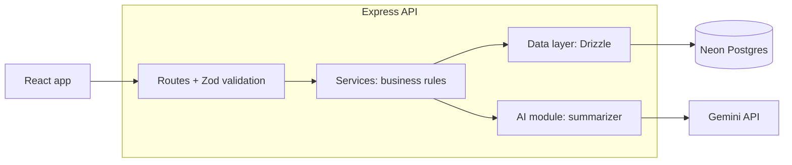

# Candidate Tracker

## Overview
A mini applicant tracking system (ATS) for managing candidates through a hiring pipeline: **Applied → Screening → Interview → Offer → Rejected**. Each candidate has a profile with their pasted resume or cover letter text, and an AI-generated summary of their key skills and experience highlights.

**Features**
- Add candidates through a form
- List candidates, filtering by stage or role and sorting by date added or stage
- Candidate detail page with the full profile and notes history
- Move a candidate between stages (any stage to any stage)
- Add timestamped, append-only notes
- Archive candidates (soft delete; nothing is lost)
- AI summary of skills and experience highlights, generated from the resume text on demand

## Tech stack and why

| Technology | What it does | Why I chose it | Tradeoff |
|---|---|---|---|
| React + Vite + TypeScript | UI, dev server and build, type checking | Familiar, so I can move fast within a 2-day scope; Vite gives a fast dev loop | Separate project from the API, so a bit more wiring |
| Node.js + Express | Handles HTTP requests and routes | Familiar and simple to reason about | Little built-in structure, so I enforce a routes / services / data layering myself |
| PostgreSQL on Neon | Stores candidates and notes | Vercel has no persistent disk, so SQLite wouldn't survive a deploy; Neon gives the same database locally and deployed | Setup needs a `DATABASE_URL` |
| Drizzle ORM | Turns TypeScript into SQL and gives typed rows from the schema | Thin over SQL and the schema is TypeScript, so types come for free | Lightly used before, so it was a learning curve |
| Zod | Validates the shape of API input and AI output at runtime | One library for both uses; types are inferred from the schema; works with Gemini's structured output | Checks shape only, not meaning; it is one layer of defence, not the whole defence |
| Gemini 2.5 Flash (`@google/genai`) | Generates the candidate summary | I have a key and know the SDK; supports structured JSON output; free tier suits a demo | Free-tier rate limits are low and may change, and free-tier prompts may be used by Google, so only seed data should be used |
| Vitest + Supertest + PGlite | Test runner, HTTP route tests, in-memory Postgres for DB tests | Tests run real SQL with no external services and no API calls | PGlite is close to Postgres but not identical |
| Vercel (planned) | Hosting for `client/` and `server/` as two projects from one repo | Already familiar; no server management | Optional; if skipped, see the deployment design in `docs/` |

## Architecture



Layers have one job each: routes handle HTTP and validation, services hold the rules, the data layer is the only code that talks SQL, and the AI module is the only code that talks to Gemini. This keeps each part testable on its own.

## The AI feature
The summarizer lives in `server/src/ai/summarizer/` as a separate module with a single entry point, `summarize(resumeText)`.

- **Preflight checks** run before any model call. Empty, too-short or mostly non-text input is rejected, and long input is truncated.
- **Prompt-injection defence:** the resume is passed as a clearly delimited block of untrusted data, and the prompt tells the model to ignore any instructions inside it.
- **Structured output:** Gemini is asked for JSON in a fixed schema, and the reply is validated again with Zod before it is stored. Anything that fails validation is rejected.
- **Never throws:** the result is one of `ok`, `unsummarizable` or `error`, so a bad resume or an API outage does not break the page.
- **On demand:** the summary is generated with a button, stored on the candidate, and can be regenerated.

TODO: add a short note on how the seed data (including the garbled and adversarial resumes) behaves.

## Getting started
TODO: fill in once the scripts exist. Planned outline:
1. Prerequisites (Node 20+, a Neon database, a Gemini API key)
2. Clone and install
3. Copy `server/.env.example` to `server/.env` and fill in `DATABASE_URL` and `GEMINI_API_KEY`
4. Run the database migration
5. Start the server and the client

## Running the tests
TODO: add the command. Tests use Vitest; database tests run on in-memory PGlite and the Gemini client is faked, so no keys or database are needed.

## Project structure
```
client/                 React app
server/src/
  app.ts                builds the Express app
  server.ts             starts the server
  routes/               HTTP and validation
  services/             business rules
  db/                   Drizzle schema, connection, migrations
  ai/summarizer/        AI module
server/tests/
docs/                   write-up, logs, deployment design
```

## Limitations and next steps
- Resume input is pasted text only; file upload is not supported
- No authentication (out of scope)
- No pagination; the list assumes a small number of candidates
- Summaries are generated on demand, not automatically
- Next: file upload, a drag-and-drop board, background summary generation, and end-to-end tests