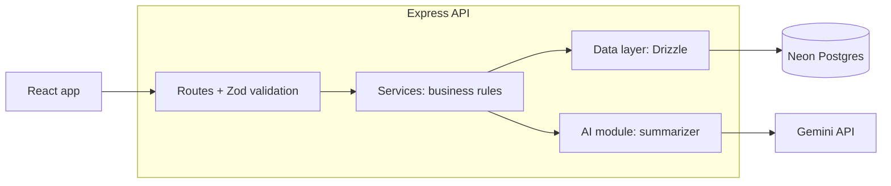

# Candidate Tracker

## Overview
A mini applicant tracking system (ATS) for managing candidates through a hiring pipeline: **Applied → Screening → Interview → Offer → Rejected**. Each candidate has a profile with their pasted resume or cover letter text, and an AI-generated summary of their key skills and experience highlights.

**Features**
- Add candidates through a form, with each validation problem shown under its field
- List candidates, filtering by stage or role and sorting by date added or stage (filters live in the URL, so a filtered view can be bookmarked or shared)
- Candidate detail page with the full profile and notes history
- Move a candidate between stages (any stage to any stage)
- Add timestamped, append-only notes
- Archive candidates (soft delete; nothing is lost)
- AI summary of skills and experience highlights, generated from the resume text on demand

## Getting started

### Prerequisites
- **Node.js 22.12+, 24 or 26+** (the repo pins 24 in `.nvmrc`; with nvm, run `nvm use`)
- A **Postgres database**. I use [Neon](https://neon.tech) (free tier); any Postgres connection string works
- A **Gemini API key** from [Google AI Studio](https://aistudio.google.com/apikey). This is optional: without it the app still runs, and summary attempts are stored as errors

### 1. Clone and install
```sh
git clone https://github.com/Sminkid/candidate-tracker.git
cd candidate-tracker
nvm use            # optional, if you use nvm

cd server
npm ci
cd ../client
npm ci
cd ..
```

### 2. Configure the server
Copy the example env file and fill in both values:
```sh
cp server/.env.example server/.env      # Windows PowerShell: Copy-Item server/.env.example server/.env
```
```
DATABASE_URL=postgresql://...      # your Neon (or other Postgres) connection string
GEMINI_API_KEY=...                 # leave empty to run without AI summaries
```
`server/.env` is gitignored. Never commit it.

### 3. Create the database tables
```sh
cd server
npm run db:migrate
```

### 4. Run the app (two terminals)
**Terminal 1: the API** (port 3000)
```sh
cd server
npm run dev
```
You should see `Server listening on http://localhost:3000`. If you left `GEMINI_API_KEY` empty, you will also see a warning that AI summaries are disabled.

**Terminal 2: the web app** (port 5173)
```sh
cd client
npm run dev
```
Open **http://localhost:5173**. In development, Vite forwards every `/api` request to the server on port 3000, so no CORS setup is needed.

The database starts empty. Use **Add candidate** to create one.

## Running the tests
No database, API key or network is needed. Database tests run on PGlite (in-memory Postgres, built from the same migration files), and the Gemini client is always faked.

```sh
cd server
npm test            # 162 tests: database, services, routes, AI summarizer
npm run typecheck

cd ../client
npm test            # 76 tests: logic and React components (fetch is faked)
npm run typecheck
npm run lint
```

## Tech stack and why

| Technology | What it does | Why I chose it | Tradeoff |
|---|---|---|---|
| React + Vite + TypeScript | UI, dev server and build, type checking | Familiar, so I can move fast within a 2-day scope; Vite gives a fast dev loop | Separate project from the API, so a bit more wiring |
| Node.js + Express | Handles HTTP requests and routes | Familiar and simple to reason about | Little built-in structure, so I enforce a routes / services / data layering myself |
| PostgreSQL on Neon | Stores candidates and notes | Vercel has no persistent disk, so SQLite wouldn't survive a deploy; Neon gives the same database locally and deployed | Setup needs a `DATABASE_URL` |
| Drizzle ORM | Turns TypeScript into SQL and gives typed rows from the schema | Thin over SQL and the schema is TypeScript, so types come for free | Lightly used before, so it was a learning curve |
| Zod | Validates the shape of API input and AI output at runtime | One library for both uses; types are inferred from the schema; works with Gemini's structured output | Checks shape only, not meaning; it is one layer of defence, not the whole defence |
| Gemini 2.5 Flash (`@google/genai`) | Generates the candidate summary | I have a key and know the SDK; supports structured JSON output; free tier suits a demo | Free-tier rate limits are low and may change, and free-tier prompts may be used by Google, so only seed data should be used |
| Vitest + Supertest + PGlite | Test runner, HTTP route tests, in-memory Postgres for DB tests | Tests run real SQL with no external services and no API calls | PGlite is close to Postgres but not identical |
| React Testing Library + jsdom | Client component tests | Tests what the user sees and does, not component internals | jsdom is not a real browser |
| Vercel (planned) | Hosting for `client/` and `server/` as two projects from one repo | Already familiar; no server management | Optional; if skipped, see the deployment design in `docs/` |

## Architecture



Layers have one job each: routes handle HTTP and validation, services hold the rules, the data layer is the only code that talks SQL, and the AI module is the only code that talks to Gemini. The database and the summarizer are passed in rather than imported, so tests can swap in PGlite and a fake model.

## Input rules
All input is validated with Zod in the route. An invalid request gets a `400` listing every problem, e.g. `name: is required; email: must be a valid email address`. The add form shows each problem under its field.

| Field | Rule |
|---|---|
| Name, role | Required, at most 200 characters |
| Email | Required, valid address, at most 100 characters; stored lowercased |
| Phone | Optional; stored as typed; at most **15 digits** (the international E.164 maximum; spaces, brackets, `+` and dashes are not counted) and 30 characters overall |
| Source | Optional, at most 100 characters |
| Resume text | Required, at most 100,000 characters |
| Note | Required, at most 5,000 characters |

Text is trimmed, and a blank optional field is stored as empty (NULL), never as a placeholder. The database repeats the most important rules: required text columns reject blank or whitespace-only values with CHECK constraints.

## The AI feature
The summarizer lives in `server/src/ai/summarizer/` as a separate module with a single entry point, `summarize(resumeText)`.

- **Preflight checks** run before any model call. Empty, too-short (under 50 characters) or mostly non-text input is rejected without calling the model, and input over 20,000 characters is truncated.
- **Prompt-injection defence:** the resume is passed as a clearly delimited block of untrusted data, and the prompt tells the model to ignore any instructions inside it. Delimiter tags inside the resume are removed (repeatedly, so `<res<resume>ume>` cannot rebuild one).
- **Structured output:** Gemini is asked for JSON in a fixed schema at low temperature, and the reply is validated again with Zod (at most 15 skills and 5 highlights, with length caps) before it is stored. Anything that fails validation is rejected.
- **Never throws:** the result is one of `ok`, `unsummarizable` or `error`, so a bad resume, a timeout (20 s) or an API outage does not break the page. Resume text is never logged.
- **On demand:** the summary is generated with a button, stored on the candidate, and can be regenerated. If a regenerate fails, the previous summary is kept and marked with the failure. An unsummarisable resume shows the reason and a **Try again** button.

TODO: add a short note on how the seed data (including the garbled and adversarial resumes) behaves.

## Project structure
```
client/src/
  api/                  API types and one function per endpoint
  lib/                  data loading, URL filters, form errors, formatting
  components/, pages/   list, add form, detail page (notes, summary card)
client/tests/           logic and component tests
server/src/
  app.ts                builds the Express app
  server.ts             starts the server
  routes/               HTTP and Zod validation
  services/             business rules
  db/                   Drizzle schema, connection, repository, migrations
  ai/summarizer/        AI module
server/tests/           database, service, route and summarizer tests
docs/                   write-up, logs, deployment design (to come)
```

## Limitations and next steps
- Resume input is pasted text only; file upload is not supported
- Resumes cannot be edited after the candidate is added
- No authentication (out of scope)
- No pagination; the list assumes a small number of candidates
- Summaries are generated on demand, not automatically
- Phone numbers are checked by digit count only, not against real number formats
- Next: seed data, file upload, a drag-and-drop board, background summary generation, and end-to-end tests
